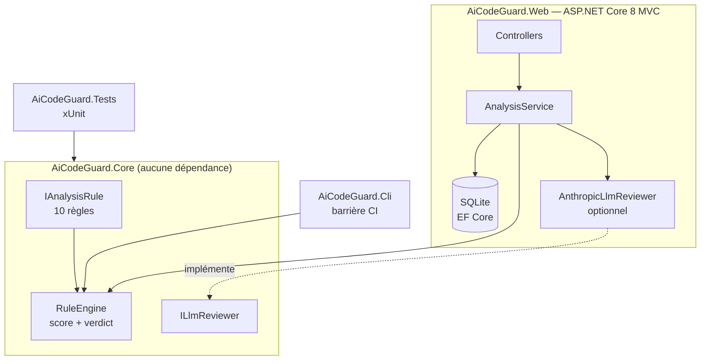

# AI Code Guard


**Un garde-fou qui contrôle le code généré par l'IA avant qu'il n'entre dans le dépôt.**

Les assistants de code (Copilot, ChatGPT, Codex, Claude Code) font gagner un temps considérable, mais ils produisent aussi des erreurs typiques : secrets écrits en dur, requêtes SQL injectables, code tronqué (`// ... reste du code`), bibliothèques inventées, `catch {}` vides…

AI Code Guard analyse un fichier C#, attribue un **score de confiance sur 100** et rend un **verdict** — *Accepté*, *À revoir* ou *Rejeté* — avec, pour chaque problème, la ligne concernée et la correction à appliquer.

> 💡 Le projet ne se limite pas à l'outil : il propose un **cadre complet d'utilisation de l'IA en équipe** — charte, processus de validation, bibliothèque de prompts, modèle de Pull Request et instructions pour agents.

---

## En 30 secondes

| | |
|---|---|
| **Problème** | Le code généré par IA est plausible, compile souvent… et contient des failles qu'une relecture rapide ne voit pas. |
| **Solution** | Un moteur de 10 règles ciblant les erreurs propres aux LLM, utilisable dans une interface web **et** dans la chaîne d'intégration continue. |
| **Principe** | L'IA propose, le développeur dispose : la décision reste humaine, l'outil fournit des preuves. |

## Démonstration

Sur l'exemple [`samples/ai-generated/UserRepository.cs`](samples/ai-generated/UserRepository.cs) — un repository typique « écrit par une IA » :

```text
$ dotnet run --project src/AiCodeGuard.Cli -- samples/ai-generated

[KO] samples/ai-generated/UserRepository.cs  —  0/100  (Rejeté)
    L4    AICG008  [Avertissement]  L'espace de noms « FastSql.AutoMapper.Extensions » n'est pas dans la liste des dépendances validées.
    L12   AICG001  [Critique]       Secret écrit en dur
    L18   AICG002  [Critique]       Risque d'injection SQL
    L20   AICG006  [Erreur]         Code incomplet (trace de génération IA)
    L26   AICG009  [Erreur]         Cryptographie obsolète
    L31   AICG005  [Erreur]         La méthode « SaveAuditAsync » est déclarée async void.
    L37   AICG003  [Erreur]         Une exception est interceptée puis ignorée.
    L44   AICG007  [Avertissement]  Appel asynchrone bloquant
    L46   AICG004  [Avertissement]  Exception générique interceptée
    L48   AICG010  [Info]           Sortie console de débogage
    L55   AICG006  [Erreur]         Code incomplet (trace de génération IA)

1 fichier(s) analysé(s) · score moyen 0/100 · seuil 80 · 1 en échec
```

La version corrigée [`samples/clean/OrderService.cs`](samples/clean/OrderService.cs) obtient **100/100 — Accepté**.

## Fonctionnalités

- 🌐 **Application web** (ASP.NET Core 8 MVC + jQuery) : coller un extrait, obtenir le rapport instantanément.
- 🗂️ **Historique** des analyses en base (Entity Framework Core + SQLite) : traçabilité de chaque contrôle.
- 📚 **Référentiel de règles** consultable, avec la justification de chaque règle face au code IA.
- ⚙️ **Outil en ligne de commande** pour la CI : code de sortie non nul si le code est rejeté, rapport Markdown archivable avec le livrable.
- 🤖 **Relecture LLM optionnelle** (API Anthropic) : second avis consultatif, désactivé par défaut, aucun code envoyé à l'extérieur sans clé configurée.
- ✅ **Tests unitaires** xUnit pour chaque règle (détection **et** absence de faux positif).
- 🔁 **Intégration continue** GitHub Actions : build, tests, barrière qualité, publication des rapports.

## Les 10 règles

| Code | Règle | Gravité | Pourquoi c'est typique de l'IA |
|---|---|---|---|
| AICG001 | Secret écrit en dur | Critique | Les modèles complètent les exemples avec des identifiants |
| AICG002 | Risque d'injection SQL | Critique | Requêtes interpolées plus courtes à générer |
| AICG003 | Bloc `catch` vide | Erreur | « Pour éviter le crash » |
| AICG004 | `catch (Exception)` générique | Avertissement | Réflexe par défaut des LLM |
| AICG005 | Méthode `async void` | Erreur | Asynchronisme mal maîtrisé |
| AICG006 | Code incomplet (`// ...`, TODO, `NotImplementedException`) | Erreur | Troncature des réponses |
| AICG007 | Appel bloquant (`.Result`, `.Wait()`) | Avertissement | Mélange sync/async → interblocages |
| AICG008 | Dépendance inconnue | Avertissement | Packages « hallucinés » (risque de *slopsquatting*) |
| AICG009 | Cryptographie obsolète (MD5, SHA1) | Erreur | Entraînement sur du code ancien |
| AICG010 | `Console.WriteLine` de débogage | Info | Code « de démonstration » |

**Score** : 100 − somme des pénalités (Info 1 · Avertissement 5 · Erreur 12 · Critique 30).
**Verdict** : ≥ 80 Accepté · 50–79 À revoir · < 50 Rejeté · **tout problème critique entraîne un rejet**.

## Architecture



**Design patterns utilisés**

| Pattern | Où | Intérêt |
|---|---|---|
| Strategy | `IAnalysisRule` | Chaque règle est indépendante et testable seule |
| Template Method | `LineRegexRule` | L'algorithme d'analyse est écrit une fois, les règles ne fournissent que leurs motifs |
| Factory | `DefaultRules` | Point unique de construction du moteur |
| Null Object | `NullLlmReviewer` | Pas de `if (llm != null)` partout quand le LLM est désactivé |
| Injection de dépendances | `Program.cs` | Couplage faible, services remplaçables pour les tests |

Ajouter une règle = créer une classe + l'enregistrer dans `DefaultRules` + écrire ses tests. **Aucune autre modification** (principe ouvert/fermé).

## Démarrage rapide

Prérequis : [.NET 8 SDK](https://dotnet.microsoft.com/download/dotnet/8.0) (ou Visual Studio 2022).

```bash
git clone https://github.com/MatthieuPelissier/ai-code-guard.git
cd ai-code-guard

dotnet test                                   # lancer les tests
dotnet run --project src/AiCodeGuard.Web      # application web → https://localhost:7180
dotnet run --project src/AiCodeGuard.Cli -- samples/ai-generated --report rapport.md
```

Sous Visual Studio : ouvrir `AiCodeGuard.sln`, définir `AiCodeGuard.Web` comme projet de démarrage, F5.

**Activer la relecture LLM (facultatif)**

```bash
cd src/AiCodeGuard.Web
dotnet user-secrets set "Llm:ApiKey" "votre-clé"
```

La clé n'est jamais écrite dans le dépôt (User Secrets).

## Intégration continue

```yaml
- name: Barrière qualité IA
  run: dotnet run --project src/AiCodeGuard.Cli -- src --min-score 80 --report ai-guard-report.md
```

Code de sortie `1` → la fusion est bloquée. La même commande s'utilise dans **TFS / Azure DevOps** (tâche « Ligne de commande »).

## Gouvernance de l'IA

| Document | Contenu |
|---|---|
| [Charte d'utilisation de l'IA](docs/CHARTE-IA.md) | Niveaux d'usage, autorisé / interdit, Definition of Done, erreurs typiques des LLM |
| [Processus de validation](docs/PROCESSUS-VALIDATION.md) | Les trois barrières, intégration CI, analyse d'incident (maintenance N3) |
| [Bibliothèque de prompts](docs/BIBLIOTHEQUE-PROMPTS.md) | Prompts testés : génération, tests, legacy, ticket N3, revue |
| [Modèle de Pull Request](.github/pull_request_template.md) | Traçabilité de l'usage de l'IA et checklist de validation |
| [AGENTS.md](AGENTS.md) | Instructions pour les agents de code (Claude Code, Codex) |

## Comment ce projet a été construit

Ce dépôt a été développé **avec l'assistance de Claude Code**, en appliquant la démarche qu'il décrit : périmètre défini à l'avance, relecture du code généré, tests unitaires pour chaque règle et vérification en intégration continue. C'est un cas concret d'utilisation encadrée de l'IA dans un projet .NET.

## Pistes d'évolution

- Analyse syntaxique avec **Roslyn** à la place des expressions régulières (moins de faux positifs)
- Extension **Visual Studio** pour analyser à l'enregistrement
- Liste de dépendances autorisées vérifiée contre l'API NuGet
- Règles configurables par projet (fichier `aicodeguard.json`)
- Tableau de bord : évolution du score moyen, règles les plus déclenchées

## Auteur

**Matthieu Pelissier** — Bac+5 Architecture des systèmes d'information, spécialisation intelligence artificielle · Clermont-Ferrand

Licence [MIT](LICENSE).
