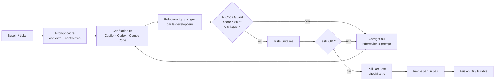

# Processus de validation du code généré par IA

## Vue d'ensemble

## Les trois barrières

| Barrière | Outil | Ce qu'elle garantit |
|---|---|---|
| 1. Automatique déterministe | AI Code Guard (règles) | Absence des erreurs connues et fréquentes des LLM |
| 2. Automatique probabiliste (optionnelle) | Relecture LLM | Un second avis sur la logique ; **consultatif uniquement** |
| 3. Humaine | Revue de PR | Adéquation au besoin, lisibilité, cohérence avec l'architecture |

Pourquoi un moteur de règles plutôt que « demander à une autre IA » ?
- **reproductible** : le même code donne toujours le même résultat ;
- **explicable** : chaque problème renvoie à une règle documentée ;
- **testable** : chaque règle a ses tests unitaires ;
- **gratuit et hors ligne** : aucun code n'est envoyé à l'extérieur.

Le LLM n'intervient qu'en complément, et seulement si l'équipe l'active.

## Intégration dans la chaîne de livraison

- **Poste développeur** : application web pour analyser un extrait avant de le coller dans le projet.
- **Intégration continue** : `aicodeguard <dossier> --min-score 80 --report rapport.md` renvoie un code de sortie non nul en cas d'échec, ce qui bloque la fusion. Le rapport Markdown est archivé avec le livrable.
- **TFS / Azure DevOps** : la même commande s'ajoute comme étape de build (tâche « Ligne de commande »).

## Analyse d'un incident lié à l'IA (maintenance niveau 3)

1. Reproduire l'anomalie et identifier le code fautif.
2. Retrouver dans la PR si le code était généré par IA, avec quel outil et quel prompt.
3. Classer l'erreur (cf. charte §5) : hallucination, troncature, sécurité, logique…
4. Corriger, puis ajouter un **test de non-régression**.
5. Si l'erreur est détectable par motif : créer une règle `AICGxxx` + ses tests.
6. Partager le retour d'expérience à l'équipe et, si besoin, mettre à jour la charte ou la bibliothèque de prompts.
